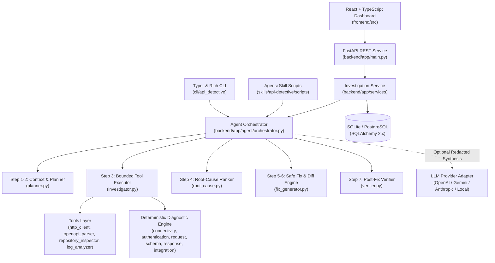

# API Detective System Architecture

API Detective is designed around a modular, deterministic-first architecture where the diagnostic engine, multi-step agent orchestrator, REST API, CLI, React web dashboard, and Agensi skill package operate with clear separation of concerns.

## Layer Responsibilities

1. **Deterministic Diagnostic Engine (`backend/app/diagnostics/`)**:
   - Six pure, independently testable analyzers (`connectivity.py`, `authentication.py`, `request_analyzer.py`, `schema_validator.py`, `response_analyzer.py`, `integration_analyzer.py`).
   - Emits standardized `DiagnosticFinding` objects with `diagnostic_id`, `category`, `severity`, `confidence`, `status`, `evidence`, and `recommendation`.
2. **Tools Layer (`backend/app/tools/`)**:
   - `http_client.py`: SSRF-validated, redirect-checked HTTP execution with response size limits and automatic secret redaction.
   - `openapi_parser.py`: Parses OpenAPI 3.0/3.1, Swagger 2.0, and JSON Schema contracts, resolves local `$ref` pointers, and matches parameterized route templates.
   - `repository_inspector.py`: Read-only static scanner for Python (`httpx`, `requests`) and JavaScript/TypeScript (`axios`, `fetch`) codebases and `.env` configurations.
   - `log_analyzer.py` & `test_runner.py`: Extracts error signatures and executes Level 4 verification checks.
3. **Agent Engine (`backend/app/agent/`)**:
   - Implements the 7-step lifecycle (`Understand -> Plan -> Execute Tools -> Analyze Root Causes -> Generate Remediation Plan -> Apply Approved Changes -> Verify`) without depending on LangChain, LangGraph, or CrewAI.
4. **Security & Redaction Core (`backend/app/core/security.py`)**:
   - Enforces SSRF protections, DNS rebinding checks, secret masking, and prompt-injection isolation.
